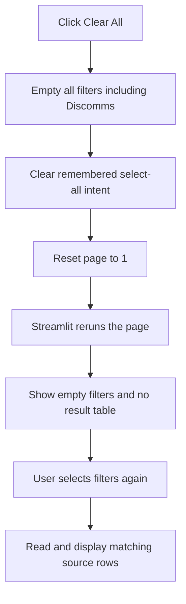
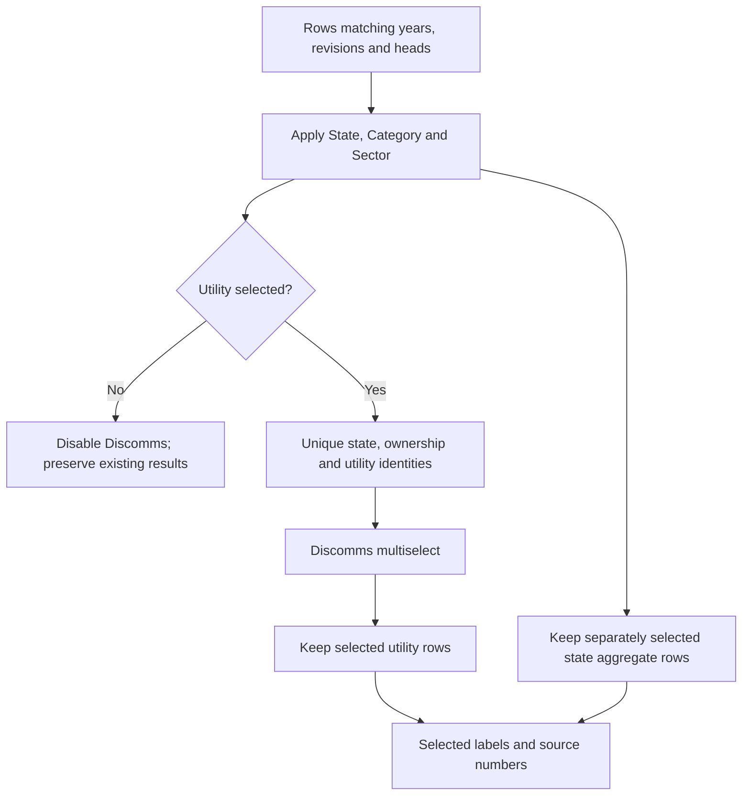
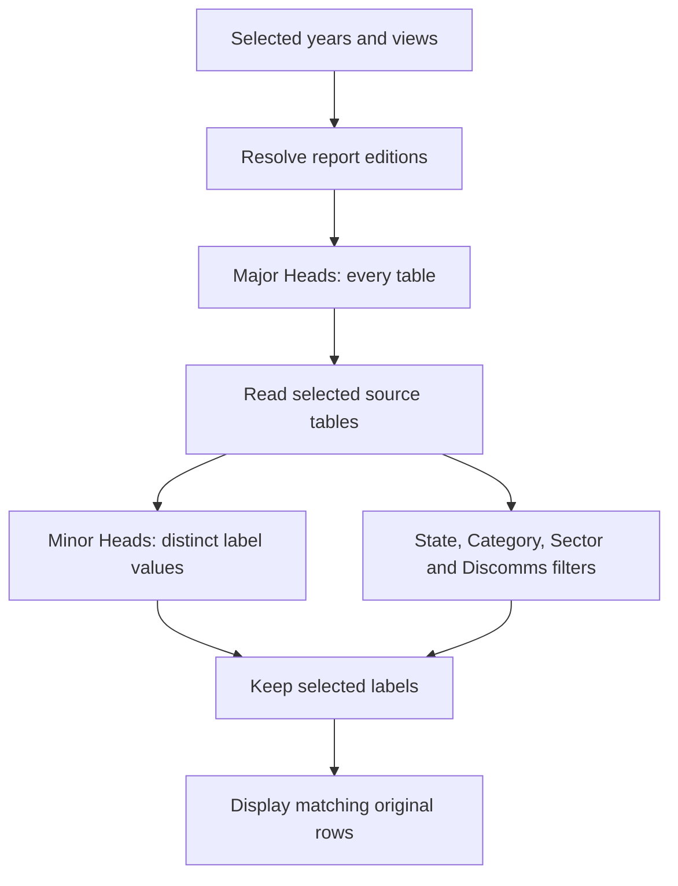
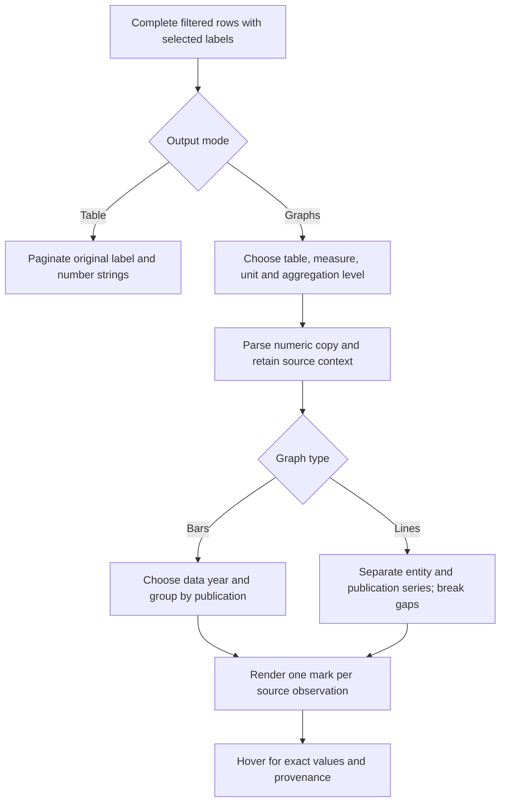

# Dashboard decisions and code guide

Last updated: 16 November 2026.

This is the maintained explanation of the current dashboard. Update the relevant
section and the change record whenever dashboard behavior changes. Earlier design
documents describe earlier releases; this file describes the current filters.
All dashboard changes stay inside `dashboard/`. The extraction code, input PDFs,
and original flat files are not edited by the dashboard.

## What the user sees

The first row is **Select year → Category → Sector → State → Major Heads → Minor Heads**.
Select view, Discomms, and Clear All are below it. The controls use ordinary
Streamlit styling. There is no custom CSS or separate frontend application.

- **Select year** selects data years, not publication years. Multiple years are allowed.
- **Category** selects Public and/or Private. Its internal key is still `sector`,
  because that is the ownership column in the source CSV.
- **Sector** selects State aggregate and/or Utility. Its internal key is
  `row_type`; the display labels map to `state_aggregate` and `utility`.
- **State** uses names from the selected files, preserving their spelling.
  Overall totals and operational group names are excluded from this list.
- **Major Heads** lists every table, including the former lettered sub-annexures, without number prefixes.
- **Minor Heads** lists the distinct original `label` values in the selected tables.
  Multiple measures can be selected. Empty means no result rows.
- **Select view** selects Latest available, Preliminary, Revision 1, and/or Revision 2.
- **Discomms** selects individual utilities from the rows matching the other
  filters. It is enabled when states and categories are selected, Sector includes
  Utility. It starts with all available utilities selected.

Each dropdown has Streamlit's native bulk selection action. There is no separate
`All` item. Empty filters, including Minor Heads, produce no results.
On first opening, the latest data year and Latest available are selected, Category,
Sector, States, Major Heads, and Minor Heads start with all their options. Clear All deliberately produces a different state from a first visit.

## Clear All

The button empties all eight multiselects and resets the
page number to 1. The existing results disappear. Rows per page is a presentation
preference, so it is retained. The button remains available when no results exist.

The callback changes only this viewer's Streamlit session state. It does not
delete data, clear shared file caches, refresh cloud copies, or affect another viewer.

An important distinction is **explicitly cleared** versus **previously selected
all, but temporarily no options are available**. The helper records both the
previous options and whether all were selected. An empty list is not, on its own,
evidence that the user selected all. Otherwise, choosing a year after Clear All
could unexpectedly refill the State filter. Explicit clears remain empty until
the user makes a new selection; an existing all-selection can follow changing options.



## How report revisions work

**Latest available** chooses the newest report in the loaded catalog that contains
each selected data year. It does not assume every year has three available
revisions and does not use the calendar date. Examples with the current snapshot:
2024-25 uses report 2024-25 (Preliminary); 2023-24 uses report 2024-25 (Revision 1);
2022-23 uses report 2024-25 (Revision 2); 2020-21 uses report 2022-23 (Revision 2).
Each selected year is resolved independently, including earlier data years carried
by the oldest included reports.

Latest available is the first dropdown option and the default for a new session.
Existing selections are preserved, and Clear All still leaves the view empty. It can be combined with explicit
revisions for comparison. Resolved report/data-year pairs are deduplicated, so
selecting Latest available and its equivalent revision does not repeat rows.
The source-report caption uses the same resolved pairs as file selection.

The report is chosen **before filtering headings**. If the newest edition omits
a heading, Latest available does not backfill that heading from an older edition.
This keeps one consistent report edition per data year. Users can explicitly
select another revision when they want its tables. A data year with no catalog
entry produces no sources rather than inventing a report.

For a data year starting in year Y, Preliminary uses the report starting in Y,
Revision 1 uses Y+1, and Revision 2 uses Y+2. For example, 2022-23 Revision 2 reads
2022-23 data from the 2024-25 report. Every selected year/view pair is considered.
Unavailable pairs are not replaced with another report or revision.

The included report editions are 2018-19 through 2024-25. They also contain
2016-17 and 2017-18 data as earlier-year revisions. Report coverage and data-year
coverage are therefore different concepts.

## Discomms: choosing individual utilities

The utility name comes from the existing `dc` field on rows whose `row_type` is
`utility`. No names, categories, states, or source rows are edited. Options are
derived after the year/view, head, State, Category, and Sector filters, so the list
cannot offer a utility absent from the currently selected data.

Each choice has the identity `(state, source category, utility name)` and displays
as `utility name (state, category)`. This distinguishes identical names across
states or ownership categories. Options are unique and sorted by state and name.
Multiple utilities and native Select all are supported; there is no All item.

Selecting a subset restricts utility rows only. If State aggregate is also
selected, its rows remain the original published state aggregates: they are not
recalculated for the selected utilities. Clearing Discomms removes utility rows
but leaves separately selected aggregate rows.

When other filters change, choices outside the new options are removed. If all
utilities were selected, the all-selection follows the newly available options.
If a subset was selected, valid choices survive and invalid ones are removed;
an empty subset does not silently select replacement utilities. Clear All also
clears this field and its remembered all-selection intent.

Unknown ownership is preserved. When both categories include unclassified source
rows, their utility choices carry `Not classified in source`; selecting one
ownership category does not assign these utilities to it.

`discomms-list.json` is a separate reference snapshot derived read-only from all
318 dashboard flat files on 12 November 2026. It contains 160 distinct
state/category/name identities with their report editions and data years. The
dashboard derives live options from its selected rows instead of using this static
reference as a whitelist, so later source changes are not blocked by an old list.
Creating this list did not modify any original or hosted CSV.



## How Major and Minor Heads are derived

Major Heads now lists all tables independently, including Revenue Structure,
Revenue Structure on Energy Sold basis, Cost Structure, and the other former
sub-annexures. `heading_options()` preserves numeric annexure order internally
without displaying annexure prefixes. Available tables appear first; catalog
headings absent from the chosen editions follow in their fallback order.

Minor Heads is a measure filter. Its options come directly from the `label` column
of the loaded selected tables, in first-source occurrence order. Duplicate labels
appear once: selecting Revenue_from_Operations selects matching rows in every
selected table containing that label. It does not equate their units or definitions.
Labels are not renamed, normalized, or matched approximately. For example,
Tariff_Subsidy_Booked and Tariff_Subsidy_Billed remain separate choices.

All measures start selected. A partial selection retains only labels still present
after changing tables or reports. Select all follows changes in available labels;
an explicitly empty selection stays empty. State and Discomms options are derived
before the measure filter, avoiding a circular dependency between those controls.

Existing sessions migrate once: old Minor Heads table choices move into Major
Heads; Minor Heads begins with the selected tables' measures. Sessions previously
cleared with Clear All remain empty. The `minor_heads_kind` session marker records
this change of meaning and is not a source-data modification.



## Result table

Only `label` and `number` are visible. Both remain the original CSV strings,
including decimal formatting. The remaining source fields stay in memory for
filtering and provenance; hiding them does not delete them. Pagination still uses
100, 250, or 500 rows and resets when filters change.

Selecting several years, states, utilities, or tables can yield repeated labels.
Every matching source row remains separate; the app does not sum, deduplicate,
or round those values. With two visible columns, the table alone cannot identify
which state/year a repeated label belongs to. Narrow filters or use graph tooltips
when that distinction is needed. Source files remain listed in the expandable guide.

## Graphs for research

The **View output as** radio switches between Table (the default) and Graphs.
Graph controls operate on the complete filtered result, not the visible table page.
Choose a **Graph measure**, then **Comparison (bars)** or **Trend (lines)**.

A graph measure is the tuple `(header, label, unit, row_type)`. The same label can
mean rupees crore in Revenue Details and rupees per kWh in Revenue Structure.
Those are separate graph choices. State aggregates and utilities are also separate;
plotting or adding them together would double count the underlying activity.
Selecting one graph measure does not alter the main filters or the two-column table.

- Bars compare states/utilities for one **Graph year** from the selected data years.
  Multiple selected publications appear as grouped, unstacked bars. The axis includes
  zero, including when values are negative. Entity labels include state, name and
  source category, preventing same-name utilities from being confused.
- Lines compare the selected data years, with points showing actual observations.
  Color identifies the state/utility; line pattern identifies the publication.
  Lines stay within one publication and stop at gaps. A single year still shows
  points. No interpolation, averaging, growth calculation or inferred total is done.
- Hover details retain the original number text, unit, state, utility, category,
  aggregation level, data year, publication, table, annexure and printed PDF page.
  Trends support zooming and panning through Altair's native interaction.

**Publication versus revision:** the chart uses the source `yop` publication label,
not a guessed revision label. A publication can contain three data years, each with
a different revision status. Latest available can choose different publications
across years, so a long latest-available trend may contain separate line segments.
This intentionally avoids presenting different publications as one consistent
report series. The main Select view filter still determines which records enter.

Numeric conversion happens on a copy in memory. Commas are removed, accounting
parentheses become negative signs, and Unicode minus signs are recognized. Blank,
non-numeric and non-finite values are omitted from charts and counted in a caption;
zero remains a real plotted value. Original table strings and all CSV files remain
unchanged. Removing a non-numeric observation also breaks the line at that year.

No chart aggregates across source rows. Each bar or point is one published
observation. Original source identities were checked for duplicate observations
across all included files. Chart measure/year selections are revalidated when main
filters change, so a removed measure cannot keep an old graph on screen.



**Why Altair?** Streamlit already installs it; it supports explicit encodings and
source tooltips. We now pin Altair directly because the code imports it directly.
Native Streamlit rendering keeps the existing look. Pie charts were not chosen:
these results can contain negative values, ratios, overlapping totals and measures
that are not parts of one additive whole. Automatic summing or averaging would
require additional research definitions and is not part of this change.

Graphs send the selected chart observations and tooltip fields to the viewer's
browser. They do not upload source data to a new service or write chart files.
Inline chart data avoids a global Altair setting and plots the chosen measure in
full. Large comparisons are tall rather than silently truncating observations;
use the existing State/Discomms filters to focus them.

API references: [Streamlit Altair charts](https://docs.streamlit.io/develop/api-reference/charts/st.altair_chart)
and [Altair data handling](https://altair-viz.github.io/user_guide/large_datasets.html).

## Totals and unknown ownership

The Totals only control has been removed. The dashboard always excludes the
published overall State Sector, Private Sector, and Grand Total rows. State
aggregates selected through Sector remain available. Existing browser sessions
with an old `totals_only=True` value cannot re-enable overall totals.

`filter_records()` retains its tested totals-selection argument for internal
compatibility, but the dashboard no longer calls that mode. The published total
rows remain untouched in the source CSVs.

No totals are calculated or added together. Selecting both categories in ordinary
mode also retains records whose ownership is `Not classified in source`. Selecting
only Public or Private excludes those records; ownership is never guessed.
The UI converts the both-category selection into an internal `All` sentinel for
the existing filtering function. That sentinel is not a dropdown option.

## Data location, cloud hosting, and caching

Locally, `data_access.py` uses the root `outputs` directory if its index exists.
Otherwise it reads `dashboard/data`. The hosted app reads the copied snapshot in
GitHub; it cannot read this computer's disk or automatically synchronize its files.
The CSV copies are uploaded with the repository and are available to the cloud
server. The browser receives the rendered controls and displayed result data.

`prepare_cloud_data.py` is a separate, manually run packaging tool. It copies the
relevant source CSV bytes into `dashboard/data`, writes the filtered cloud index,
and records SHA256 fingerprints. It preserves actual filename case for Linux.
It is not called by normal browsing or Clear All. SHA256 checks confirm copying
has not changed file contents; they do not encrypt the data.

CSV values are read as strings, keeping their original representation. The exact
12 columns are `yop, yod, ann, header, st, dc, row_type, sector, label, unit, number, pg`.
No arithmetic, unit conversion, added source columns, or editing is performed.
Graphs add temporary numeric and series columns to an in-memory copy only.
Multiple revisions can therefore show multiple source records for the same data year.

`load_files()` uses Streamlit's in-memory data cache, limited to 24 entries.
File paths, modification timestamps, and sizes are passed as cache inputs so a
changed source file invalidates its cached selection. Filter selections are kept
separately in each viewer's session. Clearing selections does not require rereading
or rewriting every CSV and does not purge cached data for other viewers.

## Function-by-function guide

### `app.py`

- `load_files(sources, signatures)`: cached wrapper around `read_sources()`;
  signatures participate in the cache key even though the body only needs sources.
- `reset_page()`: returns pagination to page 1 after a filter change.
- `clear_all()`: empties filters and remembered all-selection intent, and resets
  pagination before Streamlit redraws the widgets.
- `multiselect(...)`: creates a native multiselect, removes obsolete choices,
  migrates legacy `All` session values, and preserves explicit empty selections.
  Minor Heads follows the same explicit-empty versus select-all rules as other required filters.
- The main script reads the catalog, renders controls, chooses and loads files,
  filters rows, and displays one table page or the selected graph. Read failures and empty results stop before
  rendering a stale table. Page sizes are 100, 250, or 500 rows; the page number is
  kept within the current result's valid range.

### `data_access.py`

- `Source`: immutable description of one report/data-year/table CSV and its annexure.
- `annexure_key(value)`: converts numeric sections and letter suffixes into sortable
  components, avoiding text sorting that would put 1.10 before 1.2.
- `heading_options(catalog, year, view)`: orders available headings and appends
  unavailable catalog headings using their fallback annexures.
- `financial_year(start)`: formats a starting year as a financial-year label.
- `report_for(year, view)`: applies the 0/1/2-year revision offset.
- `selected_report_pairs(catalog, year, view)`: resolves Latest available from the
  catalog, resolves fixed revisions through `report_for()`, and returns distinct
  report/data-year pairs. `VIEWS` retains only numeric fixed offsets; `LATEST_VIEW`
  names the catalog-driven option separately, preserving source-year validation.
- `choices(value)`: lets the data helpers accept either one value or a list.
- `read_catalog(outputs)`: reads the index, restricts report editions/schema,
  validates paths stay inside the input directory, checks file existence, derives
  data years from filenames, rejects invalid revision pairs and duplicates, and
  reads each CSV's first annexure value.
- `select_sources(...)`: selects each matching source once for the selected
  resolved report/data-year pairs and requested headings. It does not substitute unavailable sources.
- `read_sources(sources)`: reads CSVs, validates column order and data year,
  concatenates them, and sorts annexures stably to preserve source row ordering.
- `state_names(frame)`: lists distinct nonempty state names, excluding overall
  totals and operational groups.
- `discomm_options(frame)`: extracts unique `(st, sector, dc)` identities from
  utility rows in the already-filtered frame, excluding empty names.
- `filter_discomms(frame, selected)`: matches full identities, restricts utility
  rows to the selected choices, and retains non-utility rows unchanged.
- `filter_records(...)`: applies State, row type, ownership, and totals rules to
  source rows and returns the original columns with a fresh row index.

### `charts.py`

- `MEASURE_FIELDS`: the four fields that distinguish a graph measure.
- `LEVEL_NAMES`: friendly names for the two aggregation levels.
- `measure_options(frame)`: unique measure tuples in source order.
- `measure_name(measure)`: readable selector text including table, unit and level.
- `prepare_chart_data(frame, measure)`: selects one measure, parses a numeric copy,
  counts unusable numbers, identifies entities, sorts financial years, and assigns
  separate line segments at publication boundaries or missing years.
- `build_chart(frame, kind, unit)`: builds an unaggregated Altair bar or line chart,
  with exact source values in tooltips and units on the value axis.
- `_choice(...)`: repairs chart-only choices that are no longer available.
- `render_graphs(result)`: displays graph controls, applies graph-specific measure
  and comparison-year choices, reports excluded values and renders the chart.

### Supporting files

- `prepare_cloud_data.py:prepare()`: explicitly packages the cloud data snapshot.
- `setup.ps1`: creates the dashboard's own virtual environment and installs pinned dependencies.
- `run_dashboard.ps1`: starts Streamlit locally, binds to localhost, and keeps
  temporary files within the dashboard directory.
- `.streamlit/config.toml`: server defaults, automatic source watching, and disabled usage telemetry.
- `.publish/`: ignored publishing checkout used to keep unrelated extraction work
  out of dashboard commits. The live branch is `main`, entrypoint `dashboard/app.py`.
- `tests/test_charts.py`: numeric parsing, source preservation, unit/level separation,
  publication identity, gap handling, real values, graph UI changes and Clear All.
- `tests/test_dashboard.py`: source integrity, revisions, totals, interface and pagination checks.
- `tests/test_filter_regressions.py`: imported-module reloads, multiselect flows,
  measure selection, empty-filter recovery, Clear All, and Discomms behavior.
- `discomms-list.json`: read-only reference snapshot of utility identities and
  their report/data-year coverage; not a runtime dependency or synchronization tool.

## Viewer link without hosting controls

Use this link for viewing and sharing:

https://open-pfc-vvwuqyzb8npyjsgmjjfqqz.streamlit.app/?embed=true

Streamlit's supported embed mode hides the toolbar, including GitHub/source and
Fork controls. The normal URL can still display Community Cloud controls,
including owner management actions. This change does not remove the public GitHub
repository or alter its visibility or permissions.

The app does not inject CSS, redirect viewers, or try to modify the hosting page.
The clean presentation depends on using the embed URL. Streamlit reserves the
`embed` query parameter; it cannot be set through `st.query_params`.

Reference: [Streamlit embed documentation](https://docs.streamlit.io/deploy/streamlit-community-cloud/share-your-app/embed-your-app).

## Decisions and alternatives

**Use a callback for Clear All.** Streamlit runs it before rendering widgets again.
Changing already-rendered widget state in the main script can raise an error.
Deleting filter keys was also rejected: it would restore initial defaults rather
than leave the fields empty. Clearing the entire session was unnecessary and would
discard presentation preferences unrelated to filtering.

**Keep the existing Streamlit architecture.** These changes need session state and
read-only filtering, not a new database or separate API service. Streamlit's Python
server already performs the backend work. A future write-back feature would need
its own storage and access decisions; it is not implemented here.

**Keep native Select all.** A second `All` item duplicated it and could conflict
with individual choices. Internal sentinels remain implementation details.

**Derive measures from the source labels.** A hardcoded measure list could drift
across editions. The old parent/child table hierarchy is removed at the user's request; annexures remain useful for sorting all tables.

**Enable source watching.** Disabling it left an older imported `data_access`
module in memory after deployment, causing `cannot import name 'head_groups'`.
Automatic watching plus a one-time hosted restart fixed that failure. A regression
test writes a changed helper in a temporary directory and verifies the new API is
available on the next script run. Changing server configuration may require restart.

**Resolve latest from the actual catalog.** Hardcoding the latest report year
would become incorrect when available editions change. Choosing latest separately
for every heading would mix report editions for the same data year. The chosen
rule uses the newest catalog edition per data year, then applies all other filters.

## Questions a new engineer might ask

**Does Clear All delete the CSVs or affect everyone?** No. It changes the current
session's filter choices only.

**Why do empty Minor Heads show no data?** Minor Heads now selects measures, not
optional additional tables. Select all to display every measure of the selected tables.

**Why does Category use a variable named `sector`?** The visible labels were changed
at the user's request while the source schema stayed intact. Category maps to the
CSV `sector`; the visible Sector maps to the CSV `row_type`.

**Why isn't every selected revision available?** Report coverage differs. The
dashboard shows available source records without manufacturing missing revisions.

**Can we sum everything displayed?** No. Units, measures, aggregation levels, and
report revisions differ. The dashboard preserves published rows rather than treating
the whole result as one additive dataset.

**Do the tests need the original extraction folders?** Most run against the bundled
cloud data when originals are absent. Checks comparing originals with copies, or
using the local integrity baseline, are explicitly skipped when those inputs are absent.

## Change record

- `21822b2`: reordered filters; Category is ownership, Sector is aggregation level.
- `8ee2a6e`: removed redundant All entries; retained native Select all.
- `189b009`: introduced optional Major/Minor Heads relationships and plain labels.
- `2df61e3`: enabled source watching and added regression coverage for stale imports.
- 11 November 2026, Clear All task: added the session-only reset button, distinguished
  an explicit empty selection from a temporarily empty all-selection, added a regression
  for clearing and rebuilding filters, and established this maintained decision guide.
  The commit containing this entry is the Clear All task commit.
- `2570fdf`: the Clear All task and initial maintained decision guide.
- 12 November 2026, Discomms task: added dependent utility selection, a separate
  reference list, and tests for ownership/state changes, multiple revisions,
  aggregate/total preservation, and Clear All. A read-only comparison confirmed
  the 318 local dashboard CSVs matched the published copies at implementation time.
  No file synchronization feature or CSV edits were introduced.
- `c07f2fe`: the Discomms task.
- 12 November 2026, Latest available task: added the catalog-driven view option,
  shared report resolution for selection and captions, and regression tests for
  all covered data years, missing editions, duplicate view choices, missing
  headings, displayed source rows, and Clear All. The fixed revision choices and
  original flat files remain unchanged.
- `1526374`: the Latest available task.
- 12 November 2026, remove totals control task: removed the Totals only widget and
  its UI callbacks, kept ordinary row filtering, updated tests to cover stale
  sessions, and documented the supported embed URL for hiding hosting controls.

- 16 November 2026, task 1: restored all tables to Major Heads and made Minor
  Heads a source-label multiselect. Added session migration and updated regression
  coverage for multiple tables, multiple measures, empty selection and recovery.

- 16 November 2026, task 2: made Latest available the initial Select view choice.
  Explicit revision choices and Clear All retain their existing behavior.

- 16 November 2026, task 3: reduced visible result columns to label and number.
  Updated interface checks to compare projected values with the original filtered
  records, preserving source ordering, duplicates and exact number strings.

- 16 November 2026, task 4: added bar comparisons and year trends with source
  tooltips, separate units/aggregation levels/publications, and chart-focused tests.
  Graphs use full filtered results; original CSVs and the cloud snapshot are untouched.

Run checks from the repository root:

```powershell
.\dashboard\.venv\Scripts\python.exe -m unittest discover -s dashboard/tests -v
```
