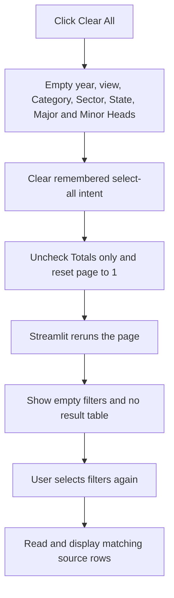
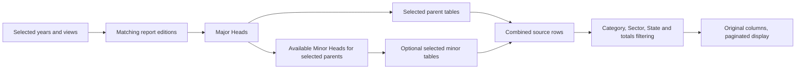

# Dashboard decisions and code guide

Last updated: 11 November 2026.

This is the maintained explanation of the current dashboard. Update the relevant
section and the change record whenever dashboard behavior changes. Earlier design
documents describe earlier releases; this file describes the current filters.
All dashboard changes stay inside `dashboard/`. The extraction code, input PDFs,
and original flat files are not edited by the dashboard.

## What the user sees

The first row is **Select year → Category → Sector → State → Major Heads → Minor Heads**.
Select view, Totals only, and Clear All are below it. The controls use ordinary
Streamlit styling. There is no custom CSS or separate frontend application.

- **Select year** selects data years, not publication years. Multiple years are allowed.
- **Category** selects Public and/or Private. Its internal key is still `sector`,
  because that is the ownership column in the source CSV.
- **Sector** selects State aggregate and/or Utility. Its internal key is
  `row_type`; the display labels map to `state_aggregate` and `utility`.
- **State** uses names from the selected files, preserving their spelling.
  Overall totals and operational group names are excluded from this list.
- **Major Heads** lists parent annexures without number prefixes.
- **Minor Heads** lists the available lettered sub-annexures belonging to the
  selected major heads. Selecting a minor adds its table alongside the parent.
  An empty Minor Heads selection means parent tables only.
- **Select view** selects Preliminary, Revision 1, and/or Revision 2.

Each dropdown has Streamlit's native bulk selection action. There is no separate
`All` item. Empty required filters produce no results; empty Minor Heads is valid.
On first opening, the latest data year and Preliminary are selected, Category,
Sector, States, and Major Heads start with all their options, and Minor Heads is
empty. Clear All deliberately produces a different state from a first visit.

## Clear All

The button empties all seven multiselects, unchecks Totals only, and resets the
page number to 1. The existing results disappear. Rows per page is a presentation
preference, so it is retained. The button remains available when no results exist.

The callback changes only this viewer's Streamlit session state. It does not
delete data, clear shared file caches, refresh cloud copies, or affect another viewer.

An important distinction is **explicitly cleared** versus **previously selected
all, but temporarily no options are available**. The helper records both the
previous options and whether all were selected. An empty list is not, on its own,
evidence that the user selected all. Otherwise, choosing a year after Clear All
could unexpectedly refill the State filter. Explicit clears remain empty until
the user makes a new selection; an existing all-selection can follow changing options.



## How report revisions work

For a data year starting in year Y, Preliminary uses the report starting in Y,
Revision 1 uses Y+1, and Revision 2 uses Y+2. For example, 2022-23 Revision 2 reads
2022-23 data from the 2024-25 report. Every selected year/view pair is considered.
Unavailable pairs are not replaced with another report or revision.

The included report editions are 2018-19 through 2024-25. They also contain
2016-17 and 2017-18 data as earlier-year revisions. Report coverage and data-year
coverage are therefore different concepts.

## How Major and Minor Heads are derived

`head_groups()` reads annexure identifiers already present in the flat-file
catalog. A lettered annexure is linked to the unlettered annexure with the same
number in the same report and data year. This avoids grouping unrelated tables
solely by their positions in a dropdown.

The report indexes were consulted when introducing this grouping:

- Revenue details: Revenue Structure; Revenue Structure on Energy Sold basis.
- Expense Details: Cost Structure; Cost Structure on Energy Sold basis.
- Profitability and Gap: Gap on Energy Sold basis; Cash Adjusted Gap where available.

Other unlettered annexures remain independent major heads. Minor options are
restricted to selected reports and years. A minor selection is removed if its
parent is deselected or its source becomes unavailable. It is not automatically
restored when that parent becomes available again.

Numeric ordering still uses annexures internally: 1.9 comes before 1.10.
Available major heads appear first in annexure order; unavailable major heads
follow, using the catalog's fallback order. The output's `ann` column is retained.



## Totals and unknown ownership

Ordinary results exclude State Sector totals, Private Sector totals, and Grand
Totals. Totals only switches to published overall total rows and disables State
and Sector, because overall totals do not belong to one state or utility type.

- Public alone selects the published State Sector total.
- Private alone selects the published Private Sector total.
- Both categories select the published combined Grand Total.
- No category selects no total rows.

No totals are calculated or added together. Selecting both categories in ordinary
mode also retains records whose ownership is `Not classified in source`. Selecting
only Public or Private excludes those records; ownership is never guessed.
The UI converts the both-category selection into an internal `All` sentinel for
the existing filtering function. That sentinel is not a dropdown option.

## Data location, cloud hosting, and caching

Locally, `data_access.py` uses the root `outputs` directory if its index exists.
Otherwise it reads `dashboard/data`. The hosted app reads the copied snapshot in
GitHub; it cannot read this computer's disk or automatically synchronize its files.
The CSV copies are uploaded with the repository and are available to the cloud
server. The browser receives the rendered controls and displayed result data.

`prepare_cloud_data.py` is a separate, manually run packaging tool. It copies the
relevant source CSV bytes into `dashboard/data`, writes the filtered cloud index,
and records SHA256 fingerprints. It preserves actual filename case for Linux.
It is not called by normal browsing or Clear All. SHA256 checks confirm copying
has not changed file contents; they do not encrypt the data.

CSV values are read as strings, keeping their original representation. The exact
12 columns are `yop, yod, ann, header, st, dc, row_type, sector, label, unit, number, pg`.
No arithmetic, unit conversion, added provenance columns, or editing is performed.
Multiple revisions can therefore show multiple source records for the same data year.

`load_files()` uses Streamlit's in-memory data cache, limited to 24 entries.
File paths, modification timestamps, and sizes are passed as cache inputs so a
changed source file invalidates its cached selection. Filter selections are kept
separately in each viewer's session. Clearing selections does not require rereading
or rewriting every CSV and does not purge cached data for other viewers.

## Function-by-function guide

### `app.py`

- `load_files(sources, signatures)`: cached wrapper around `read_sources()`;
  signatures participate in the cache key even though the body only needs sources.
- `reset_page()`: returns pagination to page 1 after a filter change.
- `clear_all()`: empties filters and remembered all-selection intent, turns totals
  off, and resets pagination before Streamlit redraws the widgets.
- `multiselect(...)`: creates a native multiselect, removes obsolete choices,
  migrates legacy `All` session values, and preserves explicit empty selections.
  Minor Heads passes an empty default and does not automatically select new children.
- `change_totals()`: resets pagination and resets State/Sector selections when
  entering totals mode. Those controls are disabled while totals mode is active.
- The main script reads the catalog, renders controls, chooses and loads files,
  filters rows, and displays one page. Read failures and empty results stop before
  rendering a stale table. Page sizes are 100, 250, or 500 rows; the page number is
  kept within the current result's valid range.

### `data_access.py`

- `Source`: immutable description of one report/data-year/table CSV and its annexure.
- `annexure_key(value)`: converts numeric sections and letter suffixes into sortable
  components, avoiding text sorting that would put 1.10 before 1.2.
- `heading_options(catalog, year, view)`: orders available headings and appends
  unavailable catalog headings using their fallback annexures.
- `head_groups(catalog, year, view)`: returns ordered major heads and available
  children by matching base and lettered annexures within each report/data year.
- `financial_year(start)`: formats a starting year as a financial-year label.
- `report_for(year, view)`: applies the 0/1/2-year revision offset.
- `choices(value)`: lets the data helpers accept either one value or a list.
- `read_catalog(outputs)`: reads the index, restricts report editions/schema,
  validates paths stay inside the input directory, checks file existence, derives
  data years from filenames, rejects invalid revision pairs and duplicates, and
  reads each CSV's first annexure value.
- `select_sources(...)`: selects each matching source once for the selected
  year/view pairs and requested headings. It does not substitute unavailable sources.
- `read_sources(sources)`: reads CSVs, validates column order and data year,
  concatenates them, and sorts annexures stably to preserve source row ordering.
- `state_names(frame)`: lists distinct nonempty state names, excluding overall
  totals and operational groups.
- `filter_records(...)`: applies State, row type, ownership, and totals rules to
  source rows and returns the original columns with a fresh row index.

### Supporting files

- `prepare_cloud_data.py:prepare()`: explicitly packages the cloud data snapshot.
- `setup.ps1`: creates the dashboard's own virtual environment and installs pinned dependencies.
- `run_dashboard.ps1`: starts Streamlit locally, binds to localhost, and keeps
  temporary files within the dashboard directory.
- `.streamlit/config.toml`: server defaults, automatic source watching, and disabled usage telemetry.
- `.publish/`: ignored publishing checkout used to keep unrelated extraction work
  out of dashboard commits. The live branch is `main`, entrypoint `dashboard/app.py`.
- `tests/test_dashboard.py`: source integrity, revisions, totals, interface and pagination checks.
- `tests/test_filter_regressions.py`: imported-module reloads, multiselect flows,
  hierarchy changes, empty-filter recovery, and Clear All behavior.

## Decisions and alternatives

**Use a callback for Clear All.** Streamlit runs it before rendering widgets again.
Changing already-rendered widget state in the main script can raise an error.
Deleting filter keys was also rejected: it would restore initial defaults rather
than leave the fields empty. Clearing the entire session was unnecessary and would
discard presentation preferences unrelated to filtering.

**Keep the existing Streamlit architecture.** These changes need session state and
read-only filtering, not a new database or separate API service. Streamlit's Python
server already performs the backend work. A future write-back feature would need
its own storage and access decisions; it is not implemented here.

**Keep native Select all.** A second `All` item duplicated it and could conflict
with individual choices. Internal sentinels remain implementation details.

**Derive hierarchy from source annexures.** A manually maintained title-to-title
mapping could drift when report editions change. The catalog already supplies the
report, data year, heading, and annexure needed to derive the relationships.

**Enable source watching.** Disabling it left an older imported `data_access`
module in memory after deployment, causing `cannot import name 'head_groups'`.
Automatic watching plus a one-time hosted restart fixed that failure. A regression
test writes a changed helper in a temporary directory and verifies the new API is
available on the next script run. Changing server configuration may require restart.

## Questions a new engineer might ask

**Does Clear All delete the CSVs or affect everyone?** No. It changes the current
session's filter choices only.

**Why do empty Minor Heads still show data?** Parent tables are selected in Major
Heads. Minor Heads is an optional addition, not a required filter.

**Why does Category use a variable named `sector`?** The visible labels were changed
at the user's request while the source schema stayed intact. Category maps to the
CSV `sector`; the visible Sector maps to the CSV `row_type`.

**Why isn't every selected revision available?** Report coverage differs. The
dashboard shows available source records without manufacturing missing revisions.

**Can we sum everything displayed?** No. Units, measures, aggregation levels, and
report revisions differ. The dashboard preserves published rows rather than treating
the whole result as one additive dataset.

**Do the tests need the original extraction folders?** Most run against the bundled
cloud data when originals are absent. Checks comparing originals with copies, or
using the local integrity baseline, are explicitly skipped when those inputs are absent.

## Change record

- `21822b2`: reordered filters; Category is ownership, Sector is aggregation level.
- `8ee2a6e`: removed redundant All entries; retained native Select all.
- `189b009`: introduced optional Major/Minor Heads relationships and plain labels.
- `2df61e3`: enabled source watching and added regression coverage for stale imports.
- 11 November 2026, Clear All task: added the session-only reset button, distinguished
  an explicit empty selection from a temporarily empty all-selection, added a regression
  for clearing and rebuilding filters, and established this maintained decision guide.
  The commit containing this entry is the Clear All task commit.

Run checks from the repository root:

```powershell
.\dashboard\.venv\Scripts\python.exe -m unittest discover -s dashboard/tests -v
```
